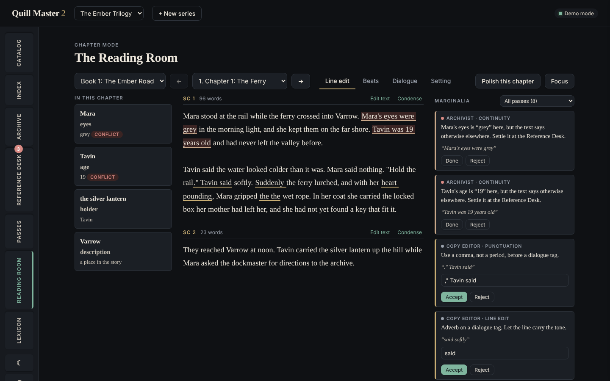

# Quill Master 2

A manuscript editor for a trilogy. It reads every book, builds a **Story Bible** of everything canon,
asks the writer about contradictions, then helps polish each chapter with eleven focused **passes**.
The AI runs on your own computer through Ollama. The manuscript never leaves it.

## What it does

**Full Manuscript mode** (understanding the story)
- **Catalog** – add Book 1, Book 2 (any `.docx`, `.odt`, `.md`, `.txt`), click **Read Full Manuscript**.
  Books are read in series order, one scene at a time. Pause any time; it picks up where it stopped.
  After editing, **Re-import**: only scenes that changed are read again. Download any book as
  Word, LibreOffice, Markdown or plain text. Italics and bold in Word files are kept.
- **Archive** – the Story Bible. Every fact shows its status (canon, found, conflict, planned, retired)
  and the sentence it came from. One Bible for the whole trilogy: ages and titles can change between
  books; eye color can't. Add planned facts for Book 3. Export as `.md` or `.docx`.
- **Reference Desk** – questions about contradictions, open storylines and possible duplicate characters.
  Every answer shows what will change before it's saved. Lines that now break canon go on the
  **To fix** list. Ask free questions about the story; answers cite their sources.
- **Index** – outline, summaries, synopsis, character summaries, storylines and the subplot matrix.

**Chapter mode** (polishing it)
- **Passes** – eleven passes, run big to small, alone or as presets (First read, Revision, Polish,
  Final check), on the whole book or chosen chapters:

  | # | Pass | Checks |
  |---|------|--------|
  | 1 | Structure | Story beats (7-point, three-act, Hero's Journey or Save the Cat), midpoint placement, scenes that don't move the plot |
  | 2 | Continuity | Lines that contradict the Story Bible |
  | 3 | Storylines | Dropped subplots, payoffs with no setup, threads quiet too long |
  | 4 | Pacing | Chapter lengths, long stretches without dialogue or events, flat tension, early climax |
  | 5 | Characterization | Voice drift (sentence length, contractions) and out-of-character lines |
  | 6 | Repetition | Repeated passages, pet phrases, scenes that cover the same beat |
  | 7 | Flow | Tense and POV slips, repeated sentence openers, monotone rhythm, clunky transitions |
  | 8 | Line edit | Filter words, tag adverbs, clichés, "suddenly", "very", weak openers, word echoes, long sentences |
  | 9 | Grammar and spelling | Built-in rules, plus LanguageTool if it's running, otherwise the AI |
  | 10 | Punctuation | Dialogue tags, dashes, ellipses, quote marks, spacing, hyphenation consistency |
  | 11 | Fact check | Real-world claims worth checking; you choose what to look up |

- **Reading Room** – the chapter with every finding marked in the text and listed in the margin.
  **Accept** applies the change (you can edit it first), **Reject** hides it for good. Four workbenches:
  Line edit, Beats (goal, conflict, outcome per scene), Dialogue (each speaker's voice, here and across
  the book) and Setting (which senses come through, whether each scene opens with place and time).
  Edit a scene directly, condense it with the Abridger, or select words to look up or replace.
  **Focus** hides everything but the text.
- **Lexicon** – definitions and synonyms (Merriam-Webster with your free keys, or the local AI), and a
  poetry form checker (haiku, tanka, limerick, sonnets, villanelle and more).
- **Backups** – before the first change to a book in each session, Quill Master offers to save a
  backup copy (a Word file in your backups folder).

---

## Install it (the easy way)

Download the installer for your computer from the
[**Releases page**](https://github.com/kornerdspider/QUILLMASTER-2/releases/latest).

### Windows
1. On the Releases page, click **QuillMaster2-Setup-Windows.exe**. It downloads to your **Downloads** folder.
2. Open **File Explorer** (the yellow folder on the taskbar), click **Downloads**, and double-click the file.
3. If a blue box says "Windows protected your PC", click **More info**, then **Run anyway**.
   (This shows because the app isn't signed with a paid certificate.)
4. Click **Next** through the installer. Leave **Put a Quill Master 2 icon on the desktop** ticked.
5. On the last screen, leave **Start Quill Master 2 now** ticked and click **Finish**.

### Mac (Apple chip: M1, M2, M3, M4)
1. On the Releases page, click **QuillMaster2-Mac.dmg**.
2. Open **Finder**, click **Downloads**, and double-click **QuillMaster2-Mac.dmg**.
3. In the window that opens, drag **Quill Master 2** onto the **Applications** folder.
4. Open **Applications** and double-click **Quill Master 2**. The Mac will say it can't check the app.
   Click **Done** (or **OK**).
5. Open **System Settings** (the gear in the Dock, or Apple menu → System Settings), click
   **Privacy & Security**, scroll down, and click **Open Anyway** next to "Quill Master 2".
   Enter your Mac password if asked. You only do this once.

### Linux (Mint)
1. On the Releases page, click **QuillMaster2-Linux.tar.gz**.
2. Open your **Downloads** folder, right-click the file, click **Extract Here**.
3. Open the new **QuillMaster2** folder, right-click an empty spot, click **Open in Terminal**, and type:
   `./install.sh`
4. Open your **Menu** and search for **Quill Master 2**.

### The AI engine (all computers)
Quill Master uses **Ollama**, a free program that runs the AI on your computer.
1. If you don't have it: go to [ollama.com/download](https://ollama.com/download), download it for your
   computer, and install it like any other app.
2. Open Quill Master 2 and click the **⚙ Settings** button at the bottom left.
3. Under **AI models**, click **Download it** next to the main model, and next to the embedding model.
   These are big downloads (a few gigabytes); the progress bar shows at the top.
4. When the pill at the top right turns green, you're ready.

To use a different model, type its name in **Model name** and click **Save**. To see what you have,
open Terminal (Mac/Linux) or Command Prompt (Windows: press the Windows key, type `cmd`, press Enter)
and type `ollama list`.

---

## First time in the app

1. **Catalog** → under **Add a book**, type the title, set **Place in the series** to 1, choose the
   file, click **Add to shelf**. Do the same for Book 2 with place 2.
   (Or click **Load the samples** to try two short books with planted mistakes.)
2. Click **Read Full Manuscript**. A 130,000-word book is a long read on a laptop; you can **Pause**.
3. **Reference Desk** → answer the questions. Your answers become canon.
4. **Passes** → click the **First read** preset, then **Run selected passes**.
5. **Reading Room** → work through each chapter's marginalia: accept, edit or reject.
6. When you're done, go back to the **Catalog** and use **Download…** to save the book as a Word file.

**Want to try it without the AI?** In **Settings**, set **Reader** to **Demo** and click **Save**.
The rule-based passes still run fully; the AI parts are skipped.

## Where your work is saved

- Windows: `C:\Users\YourName\QuillMaster2Data`
- Mac: `/Users/YourName/QuillMaster2Data`
- Linux: `/home/yourname/QuillMaster2Data`

Inside: `quillmaster2.db` (books, Story Bible, findings), `config.json` (settings), `backups`
(backup copies) and `uploads` (copies of files you added). Your original files are never changed.
Uninstalling the app doesn't delete this folder.

---

## Run from the source code (for developers)

Needs Python 3.10+.
- Windows: double-click `Start-QuillMaster2-Windows.bat`
- Mac: right-click `Start-QuillMaster2-Mac.command` → **Open**
- Linux: `./start-quillmaster2-linux.sh`

Or by hand: `pip install -r requirements.txt` (and optionally `-r requirements-desktop.txt` for the
app window), then `python run.py`. Add `--browser` to use your web browser, `--demo` for demo mode.

- `quillmaster2/importer.py` – reading files, chapters and scenes, fingerprints
- `quillmaster2/archivist.py` – the full read, Story Bible, conflicts, Q&A, documents
- `quillmaster2/passes.py` – the eleven passes
- `quillmaster2/chapter.py` – Reading Room workbenches, applying changes, backups, export
- `quillmaster2/lexicon.py` – dictionary, thesaurus, poetry forms
- `quillmaster2/llm.py` – Ollama client and the demo reader
- `quillmaster2/server.py` – the `/v2` API; `quillmaster2/static/` – the screens
- Tests: `python -m pytest tests`
- Installers are built by GitHub Actions (`.github/workflows/build.yml`) on every push, and attached
  to a release when a `v*` tag is pushed.

## Known limits

- The database is a normal file in your data folder, not encrypted.
- The apps aren't signed with paid certificates, so Windows and Mac show a warning the first time.
- The Mac build is for Apple-chip Macs (M1 and newer).
- Syllable counts in the poetry checker are estimates.
