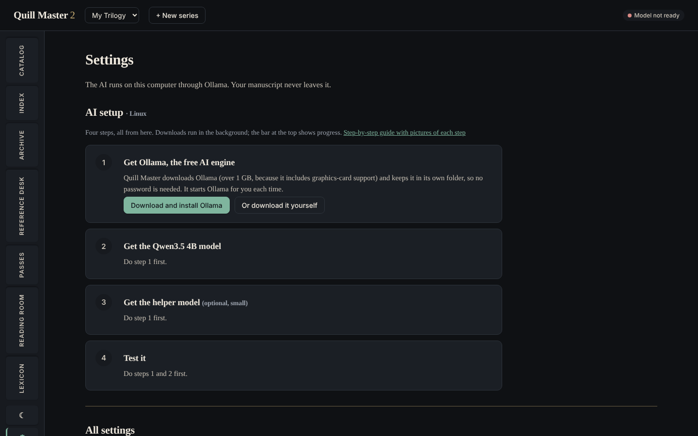
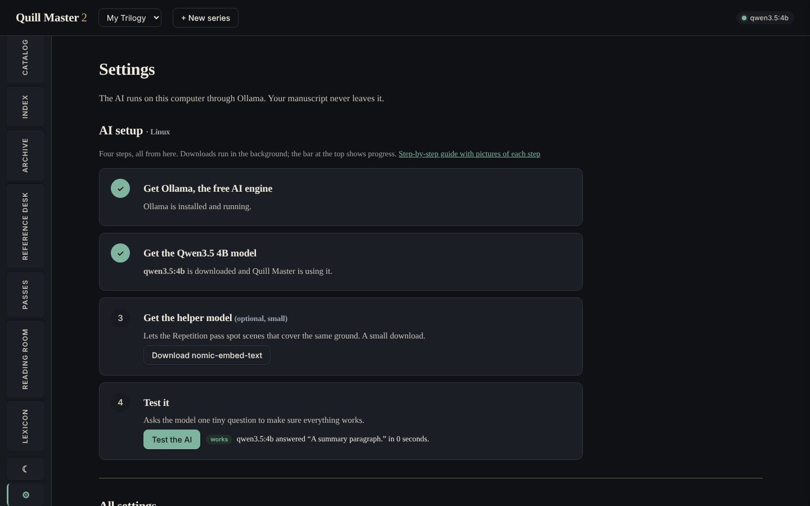

# Setting up the AI (Ollama + Qwen3.5 4B)

Quill Master 2 uses two free things to run its AI on your own computer:

- **Ollama** – the engine that runs AI models.
- **Qwen3.5 4B** (`qwen3.5:4b`) – the model that reads your books. About a **3.4 GB** download.

Nothing you write is sent over the internet. Everything runs on your computer.

**Before you start:** make sure you have about **6 GB of free disk space** and a working internet
connection for the downloads. The AI works best on a computer with **8 GB of memory or more**.

There are two ways to set it up. **Way 1 is the easy one.** Use Way 2 only if Way 1 doesn't work.

---

## Way 1: From inside Quill Master (recommended)

This works the same on Windows, Mac and Linux.

1. **Open Quill Master 2.**
2. **Click the ⚙ (gear) button** at the bottom of the left-hand menu.
   (You can also click the small colored pill at the top right of the window.)
3. At the top of Settings you'll see **AI setup** with four steps.

   

4. **Step 1 – click "Download and install Ollama".** A progress bar appears at the top of the window.
   What happens next depends on your computer:
   - **Windows:** when the download finishes, the Ollama installer window opens. Click **Install**.
     Wait until it finishes, then go back to Quill Master. You'll see a small llama icon near the clock
     at the bottom right of your screen. That means Ollama is running.
   - **Mac:** Quill Master puts Ollama in your **Applications** folder and opens it. You'll see a small
     llama icon in the menu bar at the top right of the screen. If Ollama asks to install its
     "command line" tool, you can click **Not now**; Quill Master doesn't need it.
   - **Linux:** Quill Master downloads Ollama (over 1 GB) and keeps it in its own folder. No password
     needed. Quill Master starts it for you each time you open the app.

   When Step 1 shows a green check ✓, go on.

5. **Step 2 – click "Download Qwen3.5 4B".** This is the 3.4 GB download. The progress bar shows how
   far along it is. You can keep using Quill Master while it downloads.
6. **Step 3 (optional) – click "Download nomic-embed-text".** It's small. It lets the Repetition pass
   spot scenes that cover the same ground.
7. **Step 4 – click "Test the AI".** The first answer can take up to a minute while the model loads.
   When you see a green **works** label, you're done.

   

The pill at the top right of the window now turns green and shows `qwen3.5:4b`.

---

## Way 2: By hand (if Way 1 doesn't work)

### Windows

**A. Install Ollama**
1. Open your web browser and go to **https://ollama.com/download**
2. Click **Windows**, then click the **Download** button. A file called **OllamaSetup.exe** downloads.
3. Open **File Explorer** (the yellow folder icon on the taskbar at the bottom of the screen).
4. Click **Downloads** on the left side.
5. Double-click **OllamaSetup.exe**, then click **Install**. You don't need an administrator password.
6. When it finishes, look near the clock at the bottom right of the screen. A small llama icon means
   Ollama is running. (If you don't see it, click the little **^** arrow next to the clock.)

**B. Download Qwen3.5 4B**
1. Press the **Windows key** on your keyboard (the key with the Windows logo).
2. Type `cmd` and press **Enter**. A black window called **Command Prompt** opens.
3. Click inside the black window, type this exactly, and press **Enter**:
   ```
   ollama pull qwen3.5:4b
   ```
4. Wait. You'll see a progress bar. When it says **success**, it's done.
5. To check, type this and press **Enter**:
   ```
   ollama list
   ```
   You should see `qwen3.5:4b` in the list. You can close the black window.

### Mac

**A. Install Ollama**
1. Open **Safari** (or your web browser) and go to **https://ollama.com/download**
2. Click **macOS**, then click the **Download** button.
3. Open **Finder** (the blue smiling-face icon in the Dock at the bottom of the screen).
4. Click **Downloads** on the left side.
5. Double-click the Ollama file you downloaded:
   - If it's a **.zip**, double-click it. An **Ollama** app appears next to it.
   - If it's a **.dmg**, double-click it. A window opens with the **Ollama** app inside.
6. Drag the **Ollama** app onto **Applications** (in the left side of the Finder window).
7. Click **Applications**, then double-click **Ollama**. If the Mac asks "Are you sure you want to
   open it?", click **Open**.
8. Ollama may ask to install its **command line** tool. Click **Install** and type your Mac password.
   (You need this for part B below.)
9. Look at the top right of your screen, in the menu bar. A small llama icon means Ollama is running.

**B. Download Qwen3.5 4B**
1. Press **Command (⌘) + Space** at the same time. A search bar appears.
2. Type `Terminal` and press **Return**. A window called **Terminal** opens.
3. Type this exactly and press **Return**:
   ```
   ollama pull qwen3.5:4b
   ```
4. Wait. When it says **success**, it's done.
5. To check, type this and press **Return**:
   ```
   ollama list
   ```
   You should see `qwen3.5:4b`. You can close Terminal.

### Linux (Mint)

**A. Install Ollama**
1. Open the **Terminal**: click the **Menu** button at the bottom left of the screen, type `Terminal`,
   and click it. (Or press **Ctrl + Alt + T** at the same time.)
2. Type this exactly and press **Enter**:
   ```
   curl -fsSL https://ollama.com/install.sh | sh
   ```
3. It asks for your password. Type it and press **Enter**. Nothing appears on screen while you
   type a password; that's normal.
4. Wait until it says the install is complete.
   - If it says `curl: command not found`, first type `sudo apt install curl`, press **Enter**,
     then try step 2 again.

**B. Download Qwen3.5 4B**
1. In the same Terminal window, type this and press **Enter**:
   ```
   ollama pull qwen3.5:4b
   ```
2. Wait. When it says **success**, it's done.
3. To check, type this and press **Enter**:
   ```
   ollama list
   ```
   You should see `qwen3.5:4b`.

### After Way 2 (all computers)

1. Open Quill Master 2 and click the **⚙** button.
2. Under **AI setup**, Steps 1 and 2 should show green checks. If Step 2 shows a **Use Qwen3.5 4B**
   button, click it.
3. Click **Test the AI** in Step 4.

---

## If something goes wrong

| What you see | What to do |
|---|---|
| The pill at the top right is red and says **Model not ready** | Click it. Settings opens and shows which step still needs doing. |
| **Ollama is installed but not running** | Click **Start Ollama** in Step 1. Or restart your computer; Ollama starts by itself on Windows and Mac. |
| Linux: **"this computer needs 'zstd'"** | Open Terminal, type `sudo apt install zstd`, press **Enter**, type your password, then click **Download and install Ollama** again. |
| The download stops partway | Check your internet, then click the same button again. |
| **Test the AI** takes a long time | The first answer loads the model into memory, which can take a minute. Later answers are faster. Close other big programs (games, video editors) if it stays slow. |
| You'd like a different model | In Settings, scroll to **All settings**, type the model's name in **Model name**, click **Save**, then download it the same way: `ollama pull <name>`. |

To remove Ollama later: on **Windows**, use **Settings → Apps → Installed apps → Ollama → Uninstall**.
On **Mac**, drag **Ollama** from **Applications** to the **Trash**. On **Linux**, if Quill Master
installed it, delete the `ollama` folder inside your `QuillMaster2Data` folder.
